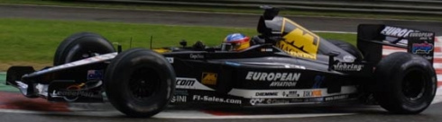

# Day 1 - Advent of OSINT 2025

**Question 1 :** Who was driving this car in this picture?

Okay so obviously my first instinct was `picture = reverse image`.

So I went over to Google's Reverse Image Search and found a Wikipedia picture that matched : https://fr.wikipedia.org/wiki/Fichier:Minardi_Ps01.jpg

Went over to the website and got the answer : **Fernando Alonso**

**Question2 :** That year, on which circuit did Alonso achieve his best result? 

Okay, from the wikipedia image we know that the image corresponds to Fernando Alonso in Minardi PS01 **2001**.
If we look up statistics on Alonso's performance during that year (https://pitwall.app/drivers/fernando-alonso/2001), we find the answer : **10th at the German Grand Prix** that took place on the **Hockenheim** circuit.

**Question 3 :** A few years later, on this same circuit, he took his revenge by winning the race. 
What was his average speed (in km/h) during that race? 

So we know we're looking for the best performance by Alonso on the Hockenheim circuit. 

The question is formulated in a way that makes it easier for us to find the answer : he won. So it must be under one of his best performances. (https://www.statsf1.com/en/fernando-alonso/palmares-ct-hockenheim.aspx)

By filtering it so, we find that it matches the results from the 2005 Germand Grand Prix. We then look for his average speed during this race (https://mg.co.za/news/sport/2005-07-25-no-luck-for-raikkonen-as-alonso-wins/) and find the answer we were looking for : **212.629 km/h**

**Rank : 106**
