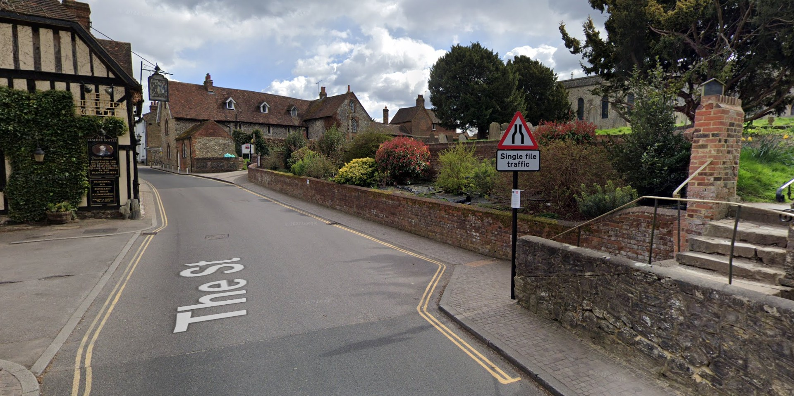
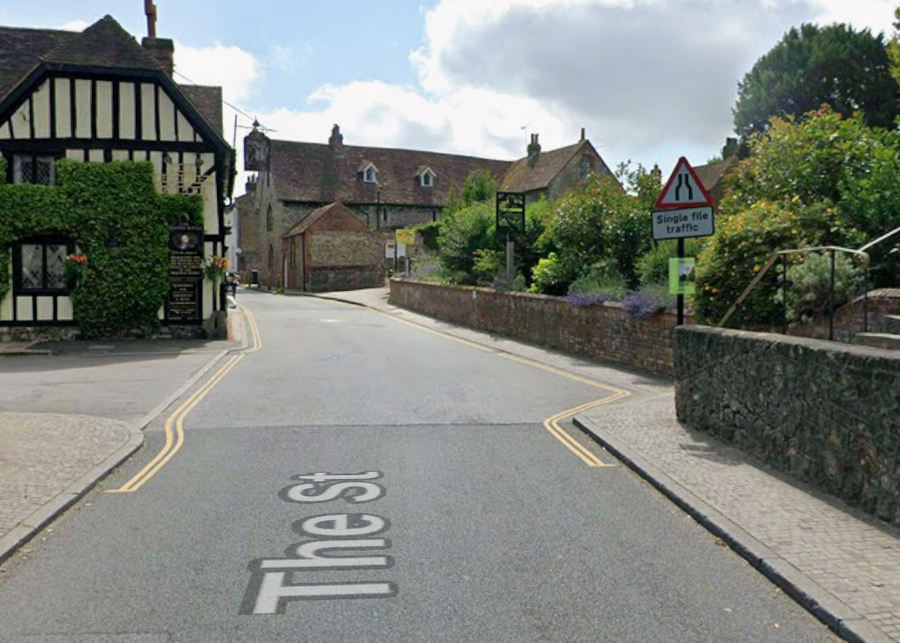
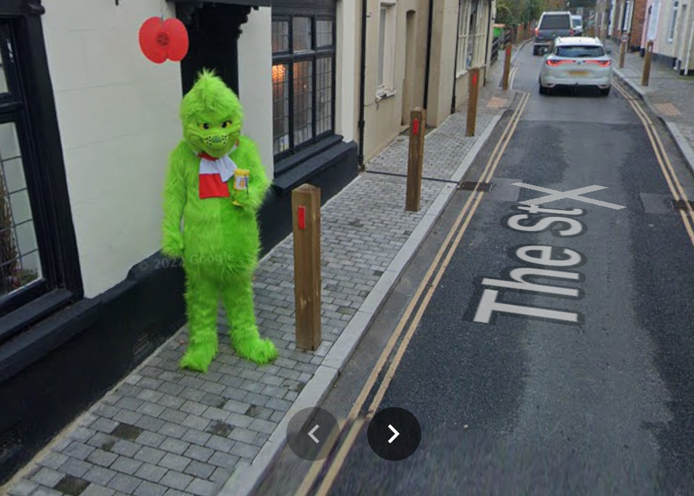

# Day 3 - Advent of OSINT 2025

**Question** :  A little further down this street, on a day in November 2022, there stood a rather unusual character.

 Who was it?

 From my somewhat vague memories, I remember that this challenge took me longer than it should've. Let's try to fix that today.

 So first thing we notice from the pictyre is there's a single file traffic sign, a building that looks like a pub on the top left corner and finally, the most interesting note is the lettering on the road, it reminds me of the Google Street View.

 So first, we have to identify the location of the photo (the pub might be of help) and secondly, look it up on Google Street View and go back to November 2022 (either via their archives or other).

 The image is a blurry but from what I can make out, the pub says something along the lines of "Leather Bottle". So I went to look into it and I found that there's a couple of Leather Bottle places around the world so to narrow it down I used the fact that on the picture we see the lettering indicating "The St" and there is in fact a **"The Leather Bottle"** hotel situated on a The Street in Gravesend, UK.

 

 I went on Street View to corroborate my hypothesis and it did in fact match the picture above (traffic sign, hotel, street name, house on the back).

 Now, we need to find the same street view from November 2022.

 Which is supposed to be quite easy since there is a view from November 2022 available directly on Google Maps but we apparently need to go a little further down the road to see the unusual character...

 And there it is! A couple of steps later we can see a **Grinch** walking down the road.

 

 **Rank : 18**